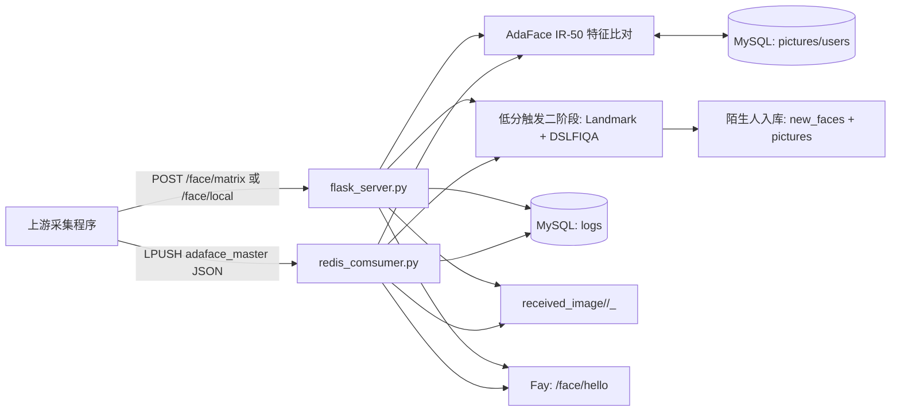
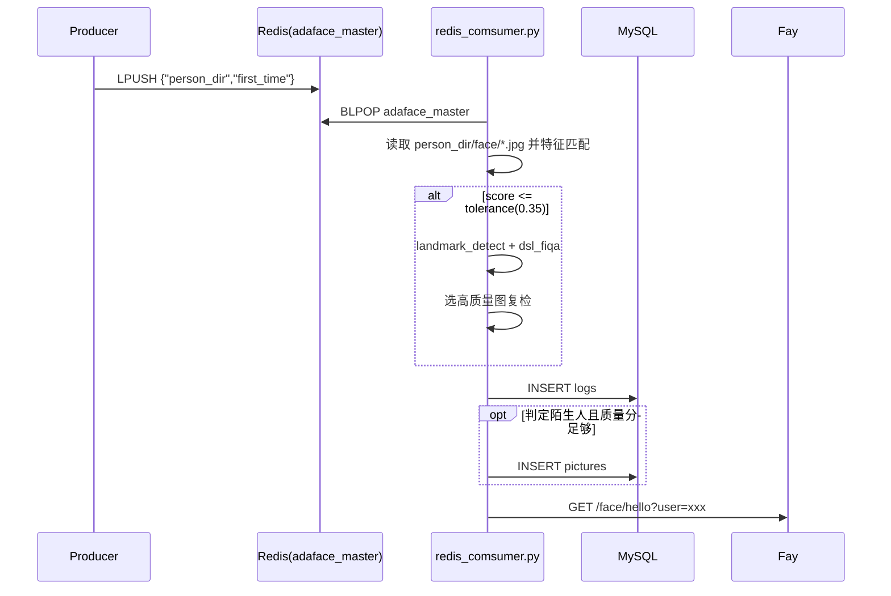

# AdaFace-master 项目对接文档

本项目是一个本地化的人脸识别服务，核心流程是：

1. 读取已登记人像（MySQL `pictures` 表）并提取 AdaFace 特征。
2. 接收一批现场图片后做一次快速匹配。
3. 低置信度时，走 Landmark + DSLFIQA 质量评估做二次精筛。
4. 仍低置信度则判为陌生人，可选入库并更新内存特征库。
5. 记录识别日志到 MySQL `logs`，并可通知外部 Fay 服务。

支持两种接入模式：

- `flask_server.py`：HTTP 接口模式
- `redis_comsumer.py`：Redis 队列消费模式（文件名按仓库现状保留 `comsumer` 拼写）

## 1. 架构图



## 2. 识别时序图（Redis 模式）



## 3. 核心能力

- 人脸识别模型：AdaFace（`pretrained/adaface_ir50_ms1mv2.ckpt`）
- 图像质量评估：DSLFIQA（`DSLFIQA/ckpt/custom/DE.pt`、`IQA.pt`）
- Landmark：FaceXFormer（`DSLFIQA/landmark_detection/ckpts/model.pt`）
- 识别结果入库：MySQL `logs`
- 动态陌生人入库：保存至 `new_faces/` 并写入 MySQL `pictures`

## 4. 项目目录（对接相关）

```text
.
├── flask_server.py                # HTTP 服务入口
├── redis_comsumer.py              # Redis 消费入口
├── inference.py                   # AdaFace 模型加载/输入预处理
├── utils.py                       # DB、特征匹配、日志、二阶段处理
├── landmark_detect.py             # landmark + 对齐逻辑
├── runtime_config.py              # location_id / camera_id
├── pretrained/
│   └── adaface_ir50_ms1mv2.ckpt
├── DSLFIQA/
│   ├── ckpt/custom/{DE.pt,IQA.pt}
│   └── landmark_detection/ckpts/model.pt
├── loaded_faces/                  # 启动时从DB加载的人像缓存
├── received_image/                # 每次识别落盘目录
└── new_faces/                     # 陌生人自动入库图片
```

## 5. 环境要求

- OS：Linux（当前代码路径、时间目录命名、文件移动逻辑均按 Linux 使用）
- Python：建议 3.9（`torch<=1.13.1` 更稳）
- CUDA：建议可用 GPU；设置 `ADAFACE_DEVICE=cpu` 也可以进行兼容性测试（速度会明显变慢）
- Redis：本机 `localhost:6379`（默认 DB `0`）
- MySQL：本机 `localhost`（默认库名 `laboratory`）

## 6. 依赖安装

Redis/HTTP 运行链路使用单独的 `requirements-runtime.txt`；原始
`requirements.txt` 仍保留用于参考/训练环境。

```bash
python -m venv .venv
source .venv/bin/activate

pip install -r requirements-runtime.txt
```

## 7. 启动前配置

### 7.1 MySQL 连接

不要把账号密码写入源码。复制上级目录的 `.env.example` 为 `.env` 并导出，或由进程管理器直接注入以下变量：

- `ADAFACE_DB_HOST`
- `ADAFACE_DB_USER`
- `ADAFACE_DB_PASSWORD`
- `ADAFACE_DB_NAME`

代码依赖的关键字段：

- `users`: `id`, `name`
- `pictures`: `id`, `user_id`, `name`, `face_image`, `score`
- `logs`: `location_id`, `camera_id`, `user_id`, `date`, `time`, `occurred_at`, `username`, `score`, `action`, `note`, `path`

### 7.2 点位配置

通过环境变量设置：

- `ADAFACE_LOCATION_ID`
- `ADAFACE_CAMERA_ID`

### 7.3 阈值与通知地址

在入口文件中可调：

- `tolerance = 0.35`
- `ADAFACE_FAY_URL` 环境变量（留空可禁用通知）

模型路径默认指向项目内被 `.gitignore` 忽略的权重文件，也可以通过 `runtime_config.py` 中对应的 `ADAFACE_*_PATH` 环境变量改到外部存储。

注意：

- `flask_server.py` 判陌生人阈值是 `score < tolerance - 0.05`
- `redis_comsumer.py` 判陌生人阈值是 `score < tolerance - 0.001`

## 8. 启动方式

### 8.1 HTTP 模式

```bash
python flask_server.py
```

默认监听：`127.0.0.1:8766`

### 8.2 Redis 模式

```bash
python redis_comsumer.py
```

默认阻塞消费队列：`adaface_master`

## 9. 对接协议

### 9.1 HTTP: `/face/matrix`（推荐给跨机器调用）

- Method: `POST`
- Body: `multipart/form-data`，上传多张图片文件（字段名任意）
- 返回示例：

```json
{
  "message": "Files uploaded and save_face recognized",
  "final_user": "张三"
}
```

调用示例：

```bash
curl -X POST http://127.0.0.1:8766/face/matrix \
  -F "img1=@/data/cam/1.jpg" \
  -F "img2=@/data/cam/2.jpg"
```

### 9.2 HTTP: `/face/local`（本机目录交接）

- Method: `POST`
- Body: JSON

```json
{
  "time": "2026-03-06 10:30:15",
  "filepath": "/abs/path/to/face_frames"
}
```

说明：

- 服务会把 `filepath` 目录下文件 `move` 到 `received_image/<date>/<time>/`
- 目录会在处理后重命名为 `..._<用户名>`

### 9.3 HTTP: `/face/undetected`（上游已判无人脸）

- Method: `POST`
- Body: JSON

```json
{
  "filepath": "/abs/path/to/face_frames/0001.jpg"
}
```

说明：接口会取该路径的父目录，移动其中 `.jpg` 到 `received_image/..._fail` 并写失败日志。

### 9.4 Redis 队列消息（推荐给同机异步流水线）

队列名：`adaface_master`

消息 JSON：

```json
{
  "person_dir": "/abs/path/to/person_xxx",
  "first_time": "2026-03-06 10:30:15"
}
```

`person_dir` 目录结构要求：

```text
person_dir/
├── face/    # 人脸帧（用于识别）
└── body/    # 全身帧（用于抽帧导出）
```

推送示例：

```bash
redis-cli LPUSH adaface_master '{"person_dir":"/data/person_001","first_time":"2026-03-06 10:30:15"}'
```

## 10. 结果与落盘说明

- 识别过程图片：`received_image/<date>/<time>/`
- 处理后重命名：`received_image/<date>/<time>_<user>` 或 `_fail`
- 二阶段中间产物：
  - `img/*.png`
  - `landmark/*.npy`
  - `dsl/<质量分>.jpg`
- 新陌生人样本：`new_faces/陌生人<uuid>.jpg`
- `load_faces()` 启动时会把 DB 人像写入 `loaded_faces/` 作为缓存

Redis 模式额外行为：

- 从 `person_dir/body` 中剔除前后各 20 张后，均匀采样 6 张
- 导出到 `ADAFACE_INDOOR_OUTPUT_PATH/<date>/<log_id>/`（默认项目内 `indoor/`）

## 11. 识别逻辑细节

1. 先对输入帧逐张提取 AdaFace embedding。
2. 与已知人脸特征做矩阵乘法相似度，按列求和，取最大身份。
3. 用 `最大和 / 输入帧数` 得到 `score`。
4. 若 `score <= tolerance`，进入二阶段质量筛选后复检。
5. 复检仍低则判为 `unknown`，并尝试陌生人入库。

## 12. 常见问题

### Q1: 启动报 CUDA 错误

处理：先设置 `ADAFACE_DEVICE=cpu` 验证代码链路；正式部署建议使用 CUDA，并确保对应的 PyTorch/torchvision 版本匹配。

### Q2: 依赖安装后仍缺包

原因：运行环境没有按本文第 6 节安装运行时依赖，或 PyTorch/torchvision 版本不匹配。  
处理：重新执行 `pip install -r requirements-runtime.txt`，再按部署环境补充与 CUDA 对应的 PyTorch/torchvision 版本。

### Q3: 为什么结果目录里原文件不见了

原因：当前实现使用 `shutil.move`，不是复制。  
处理：如需保留源文件，上游或服务侧改为 `copy2`。

### Q4: 与 Windows 共享目录时失败

原因：目录名包含 `HH:MM:SS`（冒号），Windows 文件系统不兼容。  
处理：将时间格式改成 `HH-MM-SS`。

## 13. 对接建议（上线前）

1. 统一 Redis 与 Flask 的陌生人判定阈值策略。
2. 把 MySQL/Redis/Fay 地址与账号改为环境变量，避免硬编码。
3. 增加健康检查接口（模型加载状态、DB/Redis连通性）。
4. 增加最小回归集（3 类场景：已知人、陌生人、无人脸）。
5. 评估 `loaded_faces/received_image` 的磁盘保留周期并加清理任务。

---

如需我继续，我可以直接在下一步帮你补：

- `docker-compose`（MySQL + Redis + 服务）
- `.env` 配置化改造
- 一份最小可运行的 SQL 建表脚本
